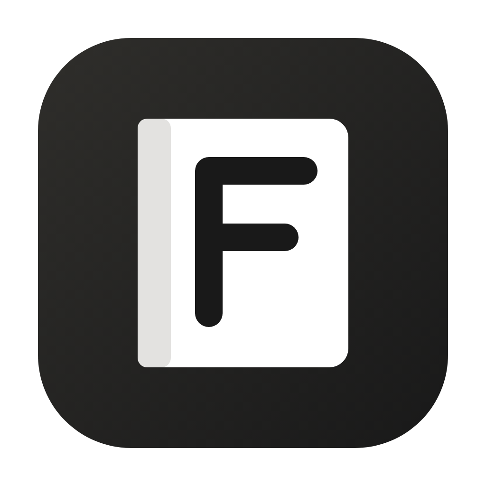
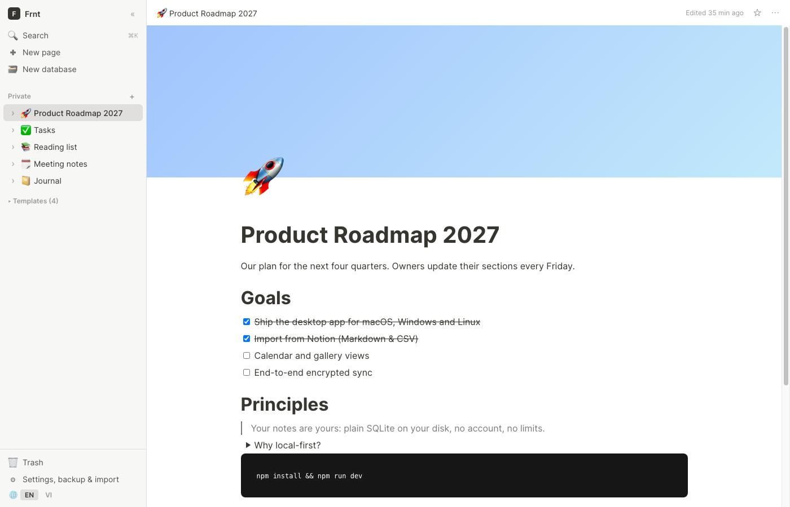
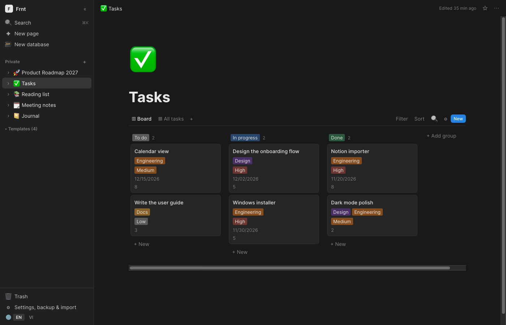
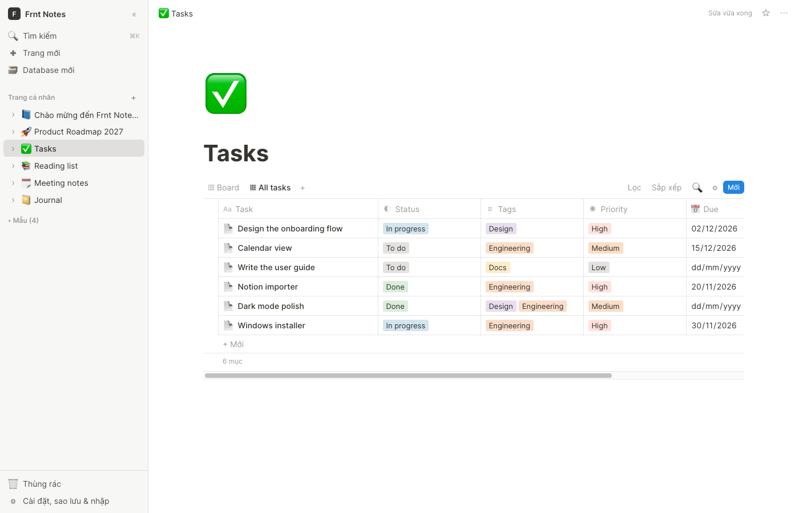

<p align="center">
  
</p>

<h1 align="center">Frnt — Free Notes</h1>

<p align="center">
  A free, open-source, <b>local-first</b> alternative to Notion.<br/>
  Block editor · nested pages · databases (table &amp; board) · version history · Notion import.<br/>
  No account. No limits. Your notes are one SQLite file on your own disk.
</p>

<p align="center">
  <a href="../../releases/latest"><b>⬇ Download</b></a> ·
  <a href="#run-from-source">Run from source</a> ·
  <a href="#frnt-vs-notion">Frnt vs Notion</a> ·
  <a href="CHANGELOG.md">Changelog</a> ·
  <a href="README.vi.md">Tiếng Việt</a>
</p>



| Board view (dark) | Table view |
|---|---|
|  |  |

## Core features

| | |
|---|---|
| ✍️ **Block editor** | Type `/` for headings, to-dos, toggles, quotes, code, tables, images/video/files, dividers. Drag blocks to reorder, use Markdown shortcuts, format with the toolbar. |
| 📄 **Pages** | Unlimited nesting, emoji icons, covers, breadcrumbs, favourites, full-width mode, drag & drop in the sidebar. |
| 🔗 **Links** | Create sub-pages inline, `@`-link any page (titles stay in sync), and see **backlinks** on every page. |
| 🗃️ **Databases** | Table and Kanban board views. 10 property types (text, number, select, multi-select, status, date, checkbox, URL, created/edited time). **Group by**, column **calculations** (count, sum, average, min/max, % checked…), filters, multi-level sorts, column resizing, several saved views per database, inline or full page. Every row is a full page. |
| 📚 **Template library** | Browse and copy ready-made templates (documents and databases) maintained in this repo. Updated templates show up as **New**, with no app update needed. [How to add one](library/README.md). |
| 🔍 **Search** | `⌘K` / `Ctrl+K` across titles and content, accent-insensitive. |
| 🕘 **Version history** | Automatic snapshots per page, with one-click restore. |
| 📋 **Templates** | Four built in, and you can save any page as a template. |
| 📥 **Import** | Notion export (Markdown & CSV `.zip`: pages, images, databases) or plain `.md` files. |
| 💾 **Your data, safe** | Autosave, trash, daily automatic backups (30 kept, folder of your choice), JSON export/restore, Markdown and PDF export. |
| 🌐 **Languages** | English and Tiếng Việt. Switch at the bottom of the sidebar. [Add yours](CONTRIBUTING.md#translations)! |
| 🌓 **Themes** | Light and dark. Resizable sidebar. |
| 🖥️ **Desktop + browser** | Native app for macOS, Windows and Linux. **🌐 Open in browser** (sidebar) shows the same notes in your web browser at `http://localhost:37291` while the app is running. |

## Moving from Notion

1. In Notion, open **Settings → General → Export all workspace content**. (For a single page: **⋯ → Export**.)
2. Choose **Export format: Markdown & CSV** and **Include subpages**. Leave "Create folders for subpages" on.
3. Notion emails you a download link. Save the `.zip` file. There's no need to unzip it.
4. In Frnt, open **Settings → Import → From Notion (.zip)** and pick the file. If Notion split the export into several parts, select all of them at once.

**From a Notion template link:** in the Template library (or Settings → Import), choose **🔗 From a Notion link** and paste the link. Frnt opens it in Notion and walks you through *Duplicate → Export (Markdown & CSV)*; drop the .zip in, and it can be saved straight to your Templates. Frnt only uses Notion's own Duplicate and Export features, because Notion offers no official way to read pages automatically.

What comes across: the page tree, text formatting, to-dos, toggles, code, quotes, images and attached files, links between pages, and databases (with property types detected: select, multi-select, date, number, URL, checkbox, text). Each database row keeps its page content.
Not yet: comments, formulas/rollups (imported as text), synced blocks and database views other than table.

Tested with a real workspace: a 615 MB export with 5,500 pages, 195 databases and 735 images imported in about 30 seconds. If anything can't be imported, the rest still is, and an **⚠️ Import report** page lists each problem with the file it came from.

## Frnt vs Notion

| | **Frnt** | **Notion Free** ¹ |
|---|---|---|
| Price | Free forever (MIT) | Free; paid plans for more |
| Where your data lives | Your computer (one SQLite file) | Notion's cloud servers |
| Account required | No | Yes |
| Works offline | Always, completely | Partly (offline mode for selected pages) |
| Pages & blocks | Unlimited | Unlimited for one person; block limit once 2+ members share a workspace |
| File uploads | No limit (your disk) | 5 MB per file |
| Page history | 100 versions per page, no time limit | 7 days |
| Backups | Automatic daily, to any folder | Manual export |
| Block editor, nested pages, `/` menu, `@` links | ✅ | ✅ |
| Databases: table & board | ✅ | ✅ |
| Databases: calendar, gallery, timeline, list | ❌ (roadmap) | ✅ |
| Relations, rollups, formulas | ❌ (roadmap) | ✅ |
| Templates | ✅ | ✅ |
| Import from Notion | ✅ | — |
| Real-time collaboration, comments, sharing | ❌ (single user) | ✅ |
| Publish pages to the web | ❌ | ✅ |
| Mobile apps | ❌ (roadmap) | ✅ |
| Sync across devices | Manual (backup folder) ² | ✅ automatic |
| AI features | ❌ (not planned) | Limited trial |
| Third-party integrations / API | ❌ | ✅ |
| Open source, self-hostable | ✅ | ❌ |

¹ Based on Notion's public pricing page as of November 2026. Plans change, so check [notion.com/pricing](https://www.notion.com/pricing).
² Point the backup folder to iCloud Drive, Google Drive or Dropbox to keep copies in the cloud. Live sync between devices is on the roadmap.

**In short:** choose Frnt if you want a private, unlimited, offline notebook that you fully own. Choose Notion if you need team collaboration, mobile apps or integrations.

## Download & install

Get the installer for your system from **[Releases](../../releases/latest)**:

| System | File |
|---|---|
| macOS, Apple Silicon (M1–M4) | `Frnt-x.y.z-mac-arm64.dmg` |
| macOS, Intel | `Frnt-x.y.z-mac-x64.dmg` |
| Windows | `Frnt-x.y.z-win-x64.exe` |
| Linux | `Frnt-x.y.z-linux-x86_64.AppImage` or `.deb` |

### System requirements

**Nothing else to install.** The installer bundles everything Frnt needs (its own runtime and database engine). You don't need Node.js, a database server or an internet connection.

| | Minimum | Recommended |
|---|---|---|
| **macOS** | 13 Ventura | 14 Sonoma or newer |
| **Windows** | Windows 10, 64-bit | Windows 11 |
| **Linux** | 64-bit, e.g. Ubuntu 22.04, Debian 12, Fedora 38 | newer |
| **CPU** | 64-bit: x64 or Apple Silicon (Windows/Linux ARM not built yet) | |
| **RAM** | 4 GB (Frnt itself uses about 200–300 MB) | 8 GB |
| **Disk** | ~300 MB for the app, plus your notes and attachments | SSD |

### First launch (unsigned builds)

The installers are **not code-signed yet**, because signing certificates cost money. Your system will warn you the first time:

- **macOS:** open the `.dmg`, drag **Frnt** to Applications, then **right-click → Open → Open**. If macOS says the app "is damaged", run `xattr -cr /Applications/Frnt.app` in Terminal.
- **Windows:** on the SmartScreen warning, click **More info → Run anyway**.
- **Linux (AppImage):** `chmod +x Frnt-*.AppImage`, then run it. Some distributions need `libfuse2` installed to run AppImages.

## Run from source

**Prerequisites:**

| Tool | Version | Notes |
|---|---|---|
| [Node.js](https://nodejs.org) | **≥ 22.13** (24 LTS recommended) | Includes npm. SQLite is built into Node, so no compiler or native build tools are needed |
| [Git](https://git-scm.com) | any | to clone the repo |

```bash
git clone https://github.com/thanhmam/frnt-notes.git
cd frnt-notes
npm install

npm run dev        # development with hot reload → http://localhost:3001
npm start          # production build in your browser → http://localhost:3001
npm run desktop    # run as a desktop app (Electron)
npm run dist       # build an installer for your current OS → ./release
```

> ⚠️ Don't keep the project folder inside iCloud Drive, OneDrive or Dropbox: they corrupt `node_modules`.

### Where is my data?

| OS | Folder |
|---|---|
| macOS | `~/Library/Application Support/FrntNotes/` |
| Windows | `%APPDATA%\FrntNotes\` |
| Linux | `~/.local/share/frnt-notes/` |

It contains `notes.db` (SQLite), `uploads/` (images and files) and `backups/`. The browser and desktop versions share the same data.
Override it with `DATA_DIR=/path`, the port with `PORT=4000`, and the language of the first-run content with `FRNT_LANG=en|vi`.

> **Network use:** Frnt works fully offline. It connects to the internet only to check GitHub for a new version once a day (can be turned off in Settings → Version & updates) and when you open the **Template library**.

**Updates:** when a new version is out, a notice appears in the sidebar. Click **Update now**: Frnt downloads the right file for your system, replaces itself and restarts. On Windows it runs the installer; on Linux it updates the AppImage.

> The server listens on `127.0.0.1` only and has **no authentication**. Don't expose it to a network (`HOST=0.0.0.0`) unless it sits behind your own authenticating reverse proxy or VPN.

## Architecture

```
server/app.js        Express + node:sqlite: pages, databases, versions, search, uploads, backups
server/seed.js       First-run welcome page & templates (en / vi)
electron/main.mjs    Desktop shell: runs the server in-process and opens a window
src/                 React frontend (Vite)
  i18n.js, locales/  Translations (English is the source language)
  Editor.jsx         BlockNote editor + custom "page" and "database" blocks
  db/                Database views (table, board, filters, sorts, cells)
  importer.js        Notion / Markdown import
```

## Roadmap

- [x] English & Vietnamese UI
- [ ] More languages (help wanted!)
- [ ] Calendar & gallery database views; relation and formula properties
- [ ] Side-peek for database rows
- [ ] Optional encrypted sync between devices
- [ ] Self-hosting (Docker image + login)
- [ ] Mobile-friendly layout and PWA
- [ ] Code-signed installers

See [CONTRIBUTING.md](CONTRIBUTING.md) to help out.

## License

[MIT](LICENSE). The editor is built on [BlockNote](https://github.com/TypeCellOS/BlockNote) (MPL-2.0).
"Notion" is a trademark of Notion Labs, Inc. Frnt is an independent project and is not affiliated with or endorsed by Notion.
