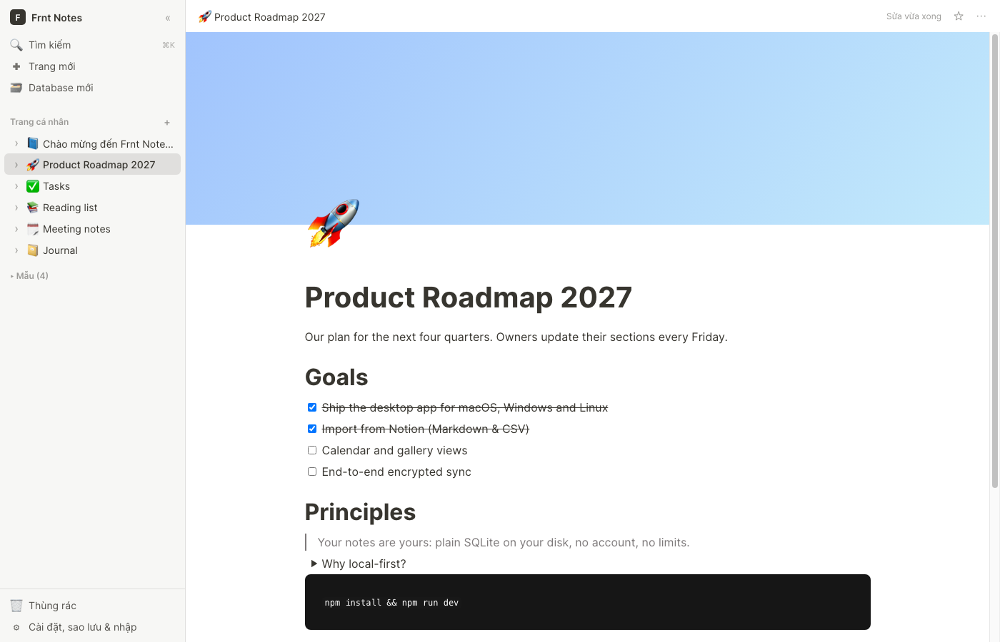

# Frnt Notes (Tiếng Việt)

Ứng dụng ghi chú thay thế Notion: **miễn phí, mã nguồn mở, chạy trên máy của bạn**.
Không cần tài khoản, không giới hạn số trang hay số block. Toàn bộ dữ liệu là một file SQLite trên ổ đĩa của bạn.

[English README](README.md)



## Tính năng
- **Editor dạng block:** gõ `/` để chèn heading, todo, toggle, quote, code, bảng, ảnh/video/file. Kéo thả block, dùng phím tắt Markdown.
- **Trang:** lồng nhau không giới hạn, icon, ảnh bìa, breadcrumb, mục yêu thích, kéo thả trong sidebar.
- **Liên kết:** gõ `/Trang con` để tạo trang con ngay trong nội dung, gõ `@` để liên kết tới trang khác. Mỗi trang hiện danh sách **backlinks** (các trang liên kết tới nó).
- **Database:** view Bảng và Board (Kanban), 10 kiểu thuộc tính, lọc, sắp xếp nhiều cấp, nhiều view cho mỗi database, nhúng trong trang hoặc mở toàn trang.
- **Tìm kiếm** `⌘K` / `Ctrl+K`, không phân biệt dấu (gõ "chao" vẫn ra "Chào").
- **Lịch sử phiên bản** cho từng trang, khôi phục bằng một click.
- **Template:** có sẵn 4 mẫu, và có thể lưu bất kỳ trang nào thành mẫu.
- **Import** từ Notion (file `.zip` Markdown & CSV, gồm cả trang con, ảnh và database) hoặc từ file `.md`.
- **An toàn dữ liệu:** tự lưu, thùng rác, sao lưu tự động hằng ngày (giữ 30 bản, chọn được thư mục), xuất/nhập JSON, xuất Markdown/PDF.

## Tải về
Vào mục **[Releases](../../releases/latest)** và tải bản phù hợp: `.dmg` cho macOS, `.exe` cho Windows, `.AppImage`/`.deb` cho Linux.

> Bản cài **chưa được ký số** vì chứng chỉ ký có phí.
> - **macOS:** chuột phải vào app, chọn **Open**, rồi chọn **Open** lần nữa (chỉ lần đầu). Nếu macOS báo "app bị hỏng", chạy lệnh `xattr -cr "/Applications/Frnt Notes.app"`.
> - **Windows:** khi SmartScreen cảnh báo, chọn **More info** rồi **Run anyway**.

## Chạy từ mã nguồn
Cần **Node.js ≥ 22.13** (khuyên dùng Node 24).
```bash
git clone https://github.com/thanhmam/frnt-notes.git
cd frnt-notes
npm install
npm run dev        # chế độ phát triển → http://localhost:3001
npm start          # bản production chạy trên trình duyệt
npm run desktop    # chạy dạng app desktop
npm run dist       # build bản cài cho hệ điều hành đang dùng → ./release
```
> ⚠️ Đừng đặt thư mục project trong iCloud/OneDrive/Dropbox vì chúng làm hỏng `node_modules`.

**Dữ liệu nằm ở:** macOS `~/Library/Application Support/FrntNotes/` · Windows `%APPDATA%\FrntNotes\` · Linux `~/.local/share/frnt-notes/`

## Đóng góp
Mọi đóng góp đều được hoan nghênh: dịch giao diện, sửa lỗi, tính năng mới. Xem [CONTRIBUTING.md](CONTRIBUTING.md).

## Giấy phép
[MIT](LICENSE): dùng miễn phí cho mọi mục đích. Dự án không liên kết với Notion Labs, Inc.
